

## NIDA Center of Excellence in Omics, Systems Genetics, and the Addictome

<a href="https://www.theaddictome.org/" aria-label="TheAddictome website"></a>

Community

Data

Tools

<h3 class="p30-title-speaker">Laura Saba, PhD</h3>
<h4>Co-Director, OSGA Center</h4>
<h4>University of Colorado Anschutz Medical Campus</h4>
<h3 class="p30-title-speaker">Hao Chen, PhD</h3>
<h4>Co-Director, OSGA Center</h4>
<h4>Single Molecule AI-assisted RaT omics (SMART) Core Lead</h4>
<h4>University of Tennessee Health Science Center</h4>
<h4 class="p30-grant-number">P30DA063727</h4>

Note: 20 seconds. Name the center, the grant number, and the three sections: community, data, tools.

---

## Rat models of human drug addiction

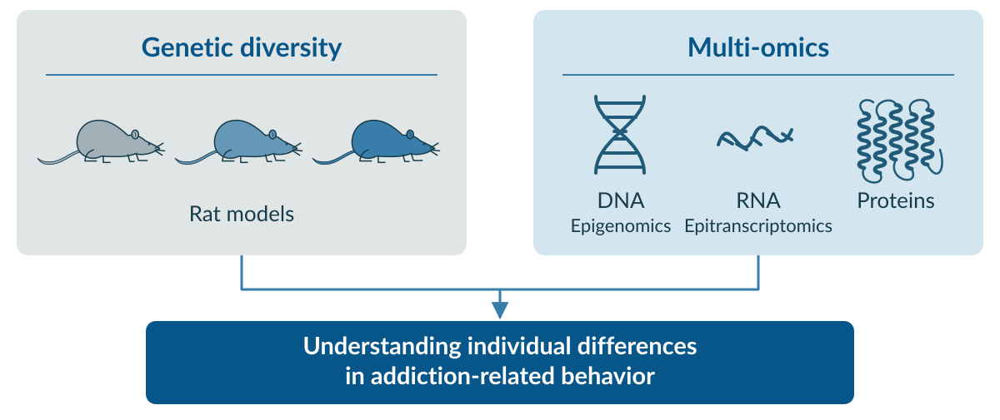

Note: 35 seconds. The center supports NIDA-funded projects that use genetically diverse rat models and multi-omics to study human drug addiction. Two complementary strengths are shown: genetic diversity and multi-omics. DNA is labeled epigenomics and RNA is labeled epitranscriptomics; the protein icon is a schematic bundle of connected helices, based on the supplied reference and drawn in the same blue line style as DNA and RNA.

---

## One center, three cores &#215; three aims

<table class="p30-matrix" aria-label="P30 cores and their contributions to community, data, and tools">
<colgroup><col style="width: 18%;"><col style="width: 27.33%;"><col style="width: 27.33%;"><col style="width: 27.34%;"></colgroup>
<thead>
<tr><th class="p30-corner"></th><th scope="col" class="p30-community-head">Build Collaborative Community</th><th scope="col" class="p30-data-head">Develop Synergistic Public Omics Data Sets</th><th scope="col" class="p30-tools-head">Create User-friendly Advanced Analysis Tools</th></tr>
</thead>
<tbody>
<tr>
<th scope="row">Administrative (Admin) Core</th>
<td class="p30-community">

Webinar seriesOn-demand learning

</td>
<td class="p30-data">

Public foundational rat omics data setsData clearinghouse

</td>
<td class="p30-tools">

TheAddictome websiteCADI-compliant REST-API

</td>
</tr>
<tr>
<th scope="row">Systems Analytics and Modeling (SAM) Core</th>
<td class="p30-community">

Building a Legacy for Genetics and Data Science (LeGenDS) internship programOpen Office Hours

</td>
<td class="p30-data">

Rat brain proteomics

</td>
<td class="p30-tools">

High-dimensional trait QTLMultiomics integration tools/softwareProteomics analysis software

</td>
</tr>
<tr>
<th scope="row">Single Molecule AI-assisted RaT omics (SMART) Core</th>
<td class="p30-community">

International Rat Omics Community (IROC) yearly and monthly meetings

</td>
<td class="p30-data">

Long read snRNA-SeqDirect RNA-SeqSingle molecule DNA methylation

</td>
<td class="p30-tools">

Reproducible agentic workflow for: omic data analysis, draft review, and SUD literature integration

</td>
</tr>
</tbody>
</table>

Note: 20 seconds. Read across the columns: community, data, tools. Every core contributes to all three. Use the icons as visual cues rather than reading each cell.

---

## Who we are

<table class="p30-team" style="font-size: 0.9em; text-align: center;">
<tr>
<td style="width: 25%; vertical-align: top;"></td>
<td style="width: 25%; vertical-align: top;"></td>
<td style="width: 25%; vertical-align: top;">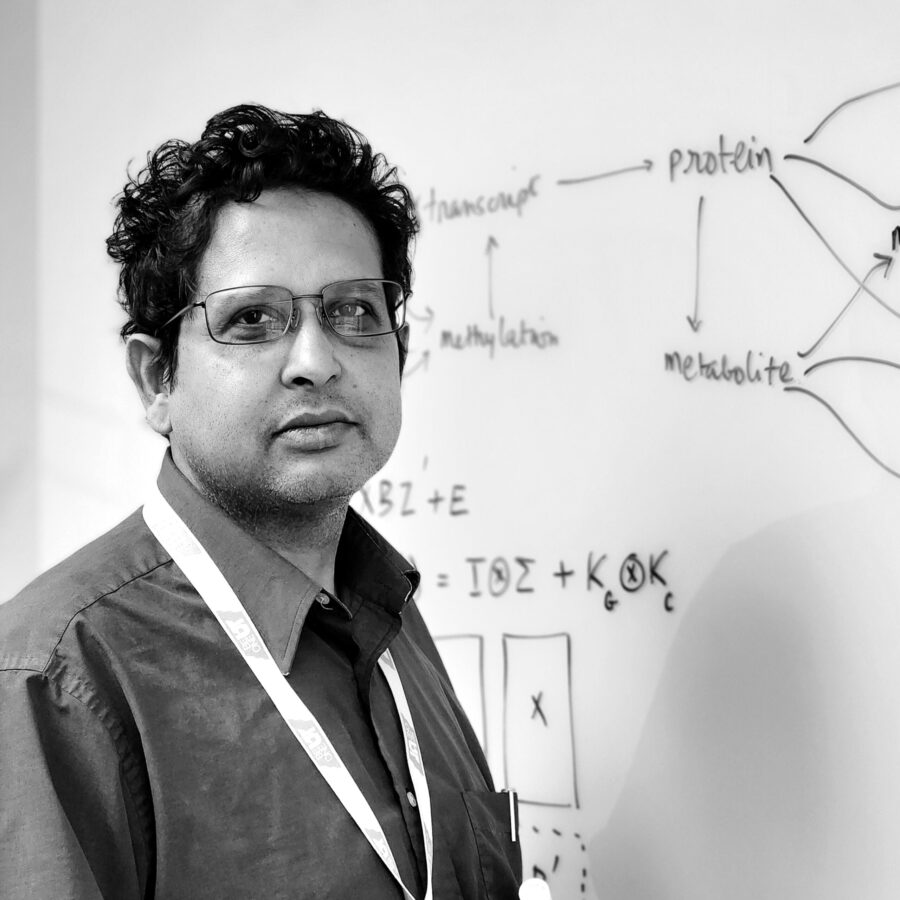</td>
<td style="width: 25%; vertical-align: top;"></td>
</tr>
<tr>
<td style="vertical-align: top;"><b>Laura Saba, PhD</b> Co-Director Admin and Pilot Core Lead CU-AMC <em>Biostatistician and bioinformatician</em></td>
<td style="vertical-align: top;"><b>Hao Chen, PhD</b> Co-Director SMART Core Lead UTHSC <em>Molecular and behavioral neuroscientist</em></td>
<td style="vertical-align: top;"><b>Saunak Sen, PhD</b> SAM Core Lead  UTHSC <em>Statistical geneticist and data scientist</em></td>
<td style="vertical-align: top;"><b>Robert W. Williams, PhD</b>   Director, 2017 - 2021  Admin Core Lead, Co-I UTHSC  <em>Quantitative systems geneticist</em></td>
</tr>
</table>

Note: 40 seconds. One clause per person. The point is that each core has a named owner.

---

## Community | Webinar series and on-demand learning

<h3><a href="https://www.youtube.com/@opar1244/featured" title="Watch the recorded series on YouTube">Recorded series</a></h3>

<strong>26 webinars</strong> · May 2020 to April 2022

<ul>
<li>Topics
<ul><li>Genetic mapping, multi-omics, causal inference, and practical data science</li></ul>
</li>
<li>Format
<ul>
<li>One hour of lecture plus 30 minutes of discussion</li>
<li>Presenters from inside and outside the center</li>
</ul>
</li>
</ul>

<h3>Restart plans</h3>
<ul>
<li>Resume monthly webinars</li>
<li>Add learning resources
<ul>
<li>Interactive notebooks</li>
<li>Micro lectures (3 - 5 minutes each)</li>
<li>Topic-focused learning tracks featuring step-by-step modules</li>
</ul>
</li>
</ul>

<strong>&gt;670</strong>registrations

<strong>&gt;1,240</strong>YouTube subscribers

<strong>&gt;73,000</strong>views

---

## Community | Pilot grants

<h3>New pilot program</h3>

Up to 15K per year

For 2 years, or in-kind core services

<ul>
<li>Cross-lab teams; early-career or transitioning PIs</li>
<li>Semiannual mentoring and annual presentation</li>
</ul>
<h4>Priority areas</h4>

Genetic diversity, Pangenomics, multiomics, brain circuitry, neuroimaging, AI

<h4>Institutional support</h4>

Both CU and UTHSC have committed institutional funds to supplement pilot funding.

<h3>Past pilots</h3>

2018 to 2019 calls 3 funded and completed projects

<ul>
<li>3 of 3 yielded publications or presentations</li>
<li>One follow-on NIDA U01 (Bryant and Kantak)</li>
<li>8,231 brain proteins quantified in one pilot dataset</li>
</ul>
<h4>Projects</h4>

Lewis rat substrains and impulsivity; SHR substrains and cocaine vulnerability; genetic control of brain proteins

Note: 40 seconds. Lead with the new pilot program, its support and priorities, and the institutional funding commitments from CU and UTHSC. The past pilots provide background rather than the main message. This completes the Admin Core community activities before SAM training and SMART/IROC.

---

## Community | Training pipeline

<table class="p30-training">
<colgroup><col style="width: 34%;"><col style="width: 33%;"><col style="width: 33%;"></colgroup>
<thead><tr><th scope="col">LeGenDS internship</th><th scope="col">Open office hours</th><th scope="col">Partner courses</th></tr></thead>
<tbody><tr>
<td style="width: 34%; vertical-align: top;">

Legacy in Genetics and Data Science  
10-week summer program 
Graduate students: mentored project to poster, paper, or software 
Labs can propose a project or sponsor a student

</td>
<td style="width: 33%; vertical-align: top;">

30-minute appointments, several slots per week 
Statistics, computation, genetics, SUD questions 
Referral and career discussion 
Launching now

</td>
<td style="width: 33%; vertical-align: top;">

NIDA Short Course on the Genetics of Addiction (R13DA052199) 
NHGRI Multi-Omics and NETwork Analysis Workshop (R25HG013296) 
NIMH International Statistical Genetics Workshop (R25MH019918)

</td>
</tr></tbody>
</table>

<ul class="p30-training-note"><li>The Addiction Genetics and Epigenetics 
<a href="https://pmc.ncbi.nlm.nih.gov/articles/PMC8365690/"> Data Jamboree </a>is planned for reinstatement as a biennial OSGA meeting.</li></ul>

Note: 40 seconds. Speak the LeGenDS outcome and the office-hours offer. Let the course numbers stand as evidence without reading them.

---

## Community | IROC

- International Rat Omics Consortium

  - monthly virtual meetings since 2019
  - about 50 participants cumulative, with RGD, EBI, and NCBI at the table.

- One biennial in-person meeting with hands-on workshops, seminars, and panel discussions.

- Paste speakers

  - Howe, Miga, Garrison, Doris, Murphy, Kwitek, Telese, Palmer, Williams, Avsec.

- Topics
  - Rn6.0, mRatBN7.2, GRCr8
  * T2T assemblies, pangenomics
  * single-cell omics, epigenomics and epitranscriptomics, AI.

---

## Data | Nexus panel, study design

<table class="p30-text-table p30-nexus">
<tr>
<td style="width: 50%; vertical-align: top;">

<b>Nexus panel : 10 inbred strains</b> 
 ACI/EurMcwi, BN/NHsdMcwi BUF/Mna, F344/DuCrl M520/NRrrcMcwi, MR/NRrrc WAG/RijCrl, WKY/Nhsd SHR/OlaIpcvMcwi, LE/StmMcwi

Founders of the N/NIH HS population 
Parents of the HXB/BXH and FXLE/LEXF panels 
 
More than 80 percent of HRDP variants 

Live rats available through MCW (Dwindell)

</td>
<td style="width: 50%; vertical-align: top;">
<b>Divergent SUD phenotypes</b> 
BN and F344: lowest intravenous nicotine intake; SHR among the highest 
ACI and SHR: high oxycodone intake; BN and M520 the lowest  
<b>Conserved risk genes</b> 
19 genes with high-impact variants whose human orthologs reach genome-wide significance in SUD GWAS 
Opioid: ARHGAP15, KDM4A, RABEPK, TANK 
Cannabis: METTL15
</td>
</tr>
</table>

- **Design:** Nexus panel, Sprague-Dawley; 6 rats per strain (3 female, 3 male), naive adults (160 to 200 days).

Note: 50 seconds. Two points: the panel covers HS and HRDP variation, and it segregates behavior. The gene list is evidence, not a reading task.

---

## Data | SAM: proteomics

<b>Xusheng Wang, PhD</b>
Former pilot grant awardee Now Co-I, SAM Core UTHSC

<h4>Completed: HXB/BXH hippocampus proteome</h4>

Li L, ..., Wang X. Genetic modulation of protein expression in rat brain. <em>iScience</em> 2025;28(3):112079. PMID 40124499.

QTL mapping, sex-specific QTL, colocalization, pangenome view, and links to human disease.

<h4>New dataset (in progress)</h4>
<table class="p30-stats">
<thead><tr><th scope="col">Nexus strains</th><th scope="col">F1 crosses</th><th scope="col">Brain regions</th><th scope="col">Rats</th></tr></thead>
<tbody><tr><td><b>10</b></td><td><b>20</b></td><td><b>2</b> NAc and mPFC</td><td><b>180</b> Both sexes</td></tr></tbody>
</table>

Map genetic regulation of protein abundance, find sex-, strain-, and region-specific effects, and integrate with RNA and behavior.

Note: 30 seconds. Wang is the pilot-to-center story, which is why he is on a data slide. State the 10-20-2-180 design and the deliverable.

---

## Data | SMART: three molecular layers

<table class="p30-text-table">
<tr>
<th>DNA methylation</th>
<th>Direct RNA</th>
<th>Long-read snRNA-seq</th>
</tr>
<tr>
<td>Epigenomics  Base-resolution 5-mC, 5-hmC Coverage enriched by adaptive sequencing   20x per CpG island</td>
<td>Epitranscriptomics  Transcript isoforms, alternative polyadenylation, poly(A) tail length, base modifications   5 million reads per sample</td>
<td>Cell-type and isoform resolution  Short and long reads from the same library      2000 - 3000 nuclie per sample</td>
</tr>
</table>

- **Platform:** Oxford Nanopore or PacBio

- **Brain regions:** NAc, mPFC.

Note: 30 seconds. Three columns, one sentence each. Name the platform choice and why, then move.

---

<!-- .slide: class="p30-combined-data" -->

## Data | SMART: DNA methylation and direct RNA

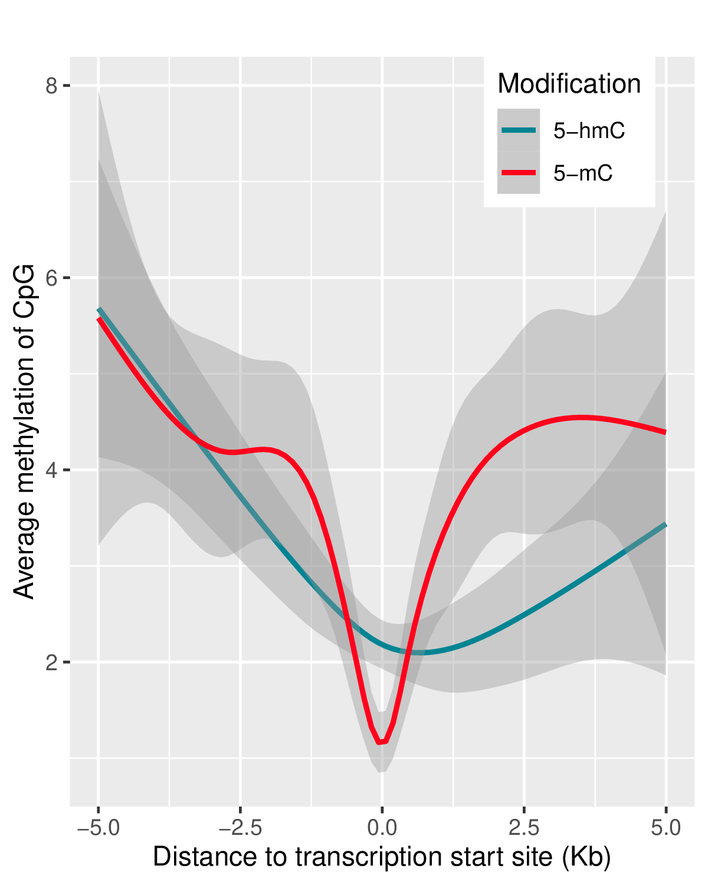

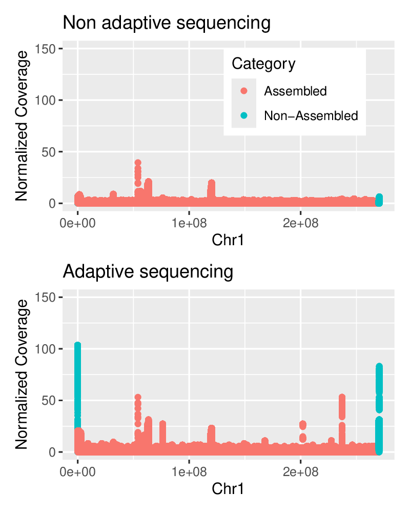

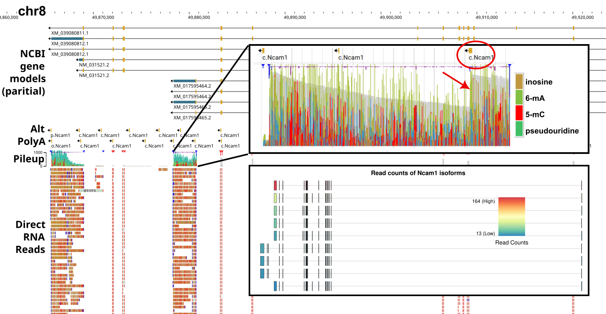

---

## Data | SMART: snRNA-seq

<table style="width: 100%;">
<tr>
<td style="width: 42%; vertical-align: top;">

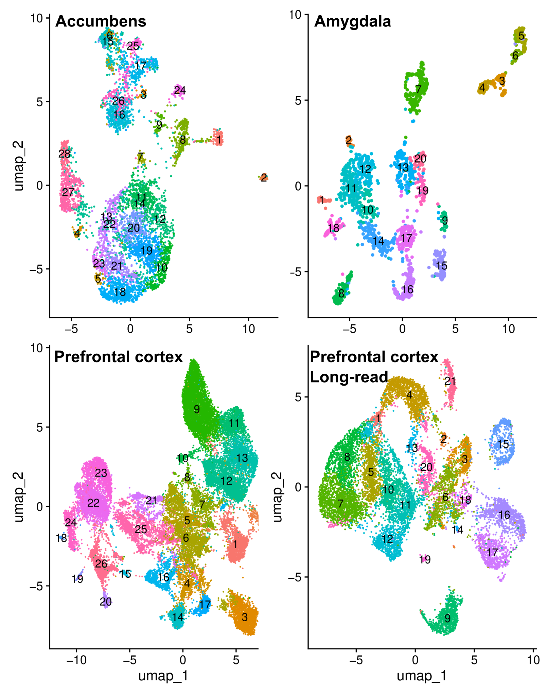

</td>
<td style="vertical-align: top;">

- Split-seq

  - Does not need specialized instrument.
  - Shared barcodes between long-read isoforms and short-read data.

- Preliminary:

  - ~ 2,000 nuclei per sample,
  - ~ 87,000 reads per nucleus,
  - ~ 5,000 genes per nucleus.

- The long-read library
  - ~ 1,500 transcripts per nucleus
  - ~ 669 bp mean length.

</td>
</tr>
</table>

Note: 20 seconds. The short-plus-long pairing from one library is the design point. Say it once.

---

## Tools | TheAddictome data clearinghouse

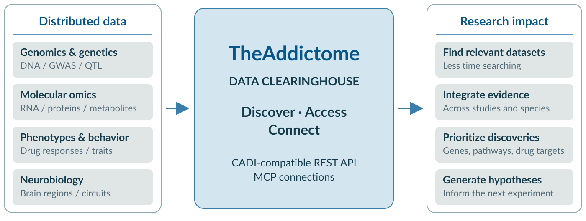

<h3 style="margin-top: 3%;"><a href="https://www.theaddictome.org">https://www.theaddictome.org</a></h3>

---

## Tools | SAM software

<table class="p30-text-table">
<colgroup><col style="width: 50%;"><col style="width: 50%;"></colgroup>
<thead><tr><th scope="col">Genetic mapping</th><th scope="col">High-dimensional data</th></tr></thead>
<tbody><tr>
<td style="width: 50%; vertical-align: top;">

<b>BulkLMM.jl</b> Large numbers of univariate linear mixed model scans, for eQTL and high-throughput phenotypes  
<b>LiteQTL.jl</b> eQTL scans on GPUs  
<b>FlxQTL.jl</b> Multivariate mixed models for structured traits: longitudinal data, correlated omics, brain regions

</td>
<td style="width: 50%; vertical-align: top;">

<b>MatrixLM.jl</b> Matrix linear models that incorporate pathway and molecular knowledge  
<b>MatrixLMnet.jl</b> Elastic net penalized matrix linear models

</td>
</tr></tbody>
</table>

Note: 15 seconds. Introduce the established genetic mapping and matrix-model software. The following slide lists the separate development projects.

---

## Tools | SAM software under development

<ul class="p30-sam-development">
<li><b>BigRiverEssence.jl</b>: Julia package for capturing the essential structure of high-dimensional data matrices using dimension reduction methods (Abhisek Banerjee, Gregory Farage).</li>
<li><b>BigRiverPlots.jl</b>: Julia package with a collection of plotting recipes for statistical visualizations (Abhisek Banerjee, Gregory Farage).</li>
<li><b>BigRiverJunbi.jl</b>: Julia package for omics data preprocessing such as imputation, normalization and transformation (Abhirath Anand, Gregory Farage).</li>
<li>Bayesian and frequentist methods for incorporating external information into omics studies (Harsh Vardhan Dubey).</li>
<li>Methods and software for analyzing partial diallel crosses.</li>
</ul>

Note: 15 seconds. Each bullet is a separate development project. Preserve the purposes and contributors on screen; do not read all names aloud. Together, the two SAM software slides retain the original 30-second allocation.

---

## Tools | SAM: proteomics analysis

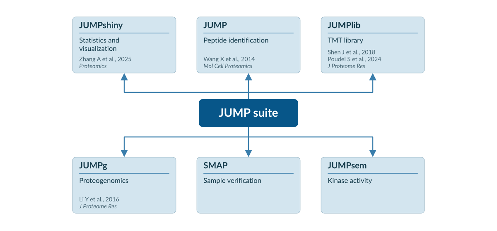

Developed by Xusheng Wang

Note: 30 seconds. Describe the JUMP suite and the six functions shown in the supplied figure. The SVG redraw preserves the tool functions and citations from the source slide.

---

## Tools | SMART: analysis path

<table class="p30-text-table p30-wide-table">
<tr>
<th>Variants</th>
<th>Cell types</th>
<th>Integration</th>
</tr>
<tr>
<td>Most non-coding predictors are trained on human data, so we test and adapt them for rat  DeepVariant and GLnexus SnpEff, ANNOVAR, VEP, PolyPhen-2, SIFT Enformer and AlphaGenome DeepSEA and DNA Hyena phastCons and phyloP</td>
<td>scGPT, pretrained on 33 million cells, fine-tuned on rat tissue  Long-read isoforms projected through shared barcodes  Label transfer annotates datasets from supported grants</td>
<td>Transcript and protein abundance often disagree; we read that as post-transcriptional regulation  MOFA with the SAM Core combines genomic, epigenomic, transcriptomic, epitranscriptomic, and proteomic data into latent factors  Links upstream variants to downstream regulation</td>
</tr>
</table>

Note: 40 seconds. Densest slide in the deck. Speak only the three steps: call variants, assign cell types, integrate layers. Let the tool names sit as evidence.

---

## Tools | SMART: AI-assisted workflow

<h3>beaver-data</h3>

Reproducible, stage-gated omics data analysis

<a class="p30-workflow-repo" href="https://github.com/chen42/beaver-data">github.com/chen42/beaver-data</a>

<a href="https://github.com/chen42/weaver-text">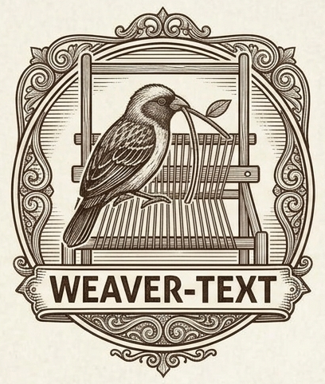</a>
<h3>weaver-text</h3>

Author-led, evidence-linked manuscript editing

<a class="p30-workflow-repo" href="https://github.com/chen42/weaver-text">github.com/chen42/weaver-text</a>

<h3>honeybee-lit</h3>

Source-tracked, investigator-guided literature search

<a class="p30-workflow-repo" href="https://github.com/chen42/honeybee-lit">github.com/chen42/honeybee-lit</a>

<a href="https://github.com/chen42/wasp-lit">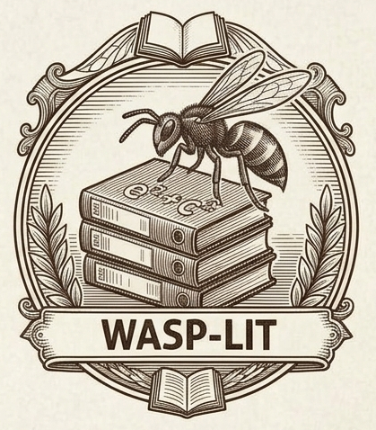</a>
<h3>wasp-lit</h3>

Gene-to-phenotype, post-GWAS literature synthesis

<a class="p30-workflow-repo" href="https://github.com/chen42/wasp-lit">github.com/chen42/wasp-lit</a>

Note: 30 seconds. Name the four tools and their functions. Each repository icon and URL links to GitHub. Emphasize reproducible analysis, author-led writing, and source-tracked literature work.

---

## Acknowledgements

NIDA Center of Excellence in Omics, Systems Genetics, and the Addictome (P30DA063727)

<h3>Special thank you to</h3>
<ul>
<li>Amy Lossie, NIDA</li>
<li>Jonathan Pollock, NIDA</li>
<li>Roger Little, NIDA</li>
</ul>
<h3>Additional financial support</h3>

<h4>CU-AMC</h4>
<ul>
<li>Department of Pharmaceutical Sciences - Blake Hill, Chair</li>
<li>Associate Dean of Research and Graduate Studies - Manisha Patel</li>
<li>Vice Chancellor of Research - Tom Flaig</li>

</ul>

<h4>UTHSC</h4>
<ul><li>School of Medicine, Dean - Michael Hocker, MD</li></ul>

<h3>Additional letters of support</h3>
<ul>
<li>Mindy Dwinell, MCW/HRDP</li>
<li>Anne Kwitek, MCW/RGD</li>
<li>G. Allan Johnson, Duke</li>
<li>Suzanne Mitchell, OHSU</li>
<li>Walker Rogers, VCU</li>
<li>Joe Lombardo, UNLV</li>
<li>Arpana Agrawal, Wash U at SL</li>
<li>Karl Broman, UW-Madison</li>
<li>Elissa Chesler, Jax Labs</li>
<li>Karen J. Derefinko, UTHSC</li>
<li>Boris Tabakoff, CU Boulder</li>
<li>Katherine Ayers, St. Jude's</li>
<li>Isaac O. Donkor, UTHSC</li>
<li>TuKiet T. Lam, Yale / NIDA Neuroproteomics Center</li>
<li>Kenneth R Williams, Yale / NIDA Neuroproteomics Center</li>
<li>Angus C. Nairn, Yale / NIDA Neuroproteomics Center</li>
<li>Camron Bryant, Northeastern</li>
</ul>

---

## Acknowledgements

#### NIDA Center of Excellence in Omics, Systems Genetics, and the Addictome (P30DA063727)

<h3>Admin Core</h3>
<ul>
<li><em>Center Co-Director</em> - Laura Saba, CU-AMC</li>
<li>Rob Williams, UTHSC</li>
<li>Katerina Kechris, CU-AMC</li>
<li>Pjotr Prins, UTHSC</li>
<li>Spencer Mahaffey, CU-AMC</li>
<li>Arthur Centeno, UTHSC</li>
</ul>

<h3>SAM Core</h3>
<ul>
<li><em>Core Lead</em> - Saunak Sen, UTHSC</li>
<li>Xusheng Wang, UTHSC</li>
<li>Gregory Farage, UTHSC</li>
<li>Hyo-Young Choi, UTHSC</li>
<li>Michelle Martin, UTHSC</li>
<li>Athena Starland-Davenport, UTHSC</li>
<li>Jamie Bowen, UTHSC</li>
<li>Aijun Zhang, UTHSC</li>
</ul>

<h3>SMART Core</h3>
<ul>
<li><em>Core Lead</em> - Hao Chen, UTHSC</li>
<li>Rachel Ward, UTHSC</li>
</ul>

