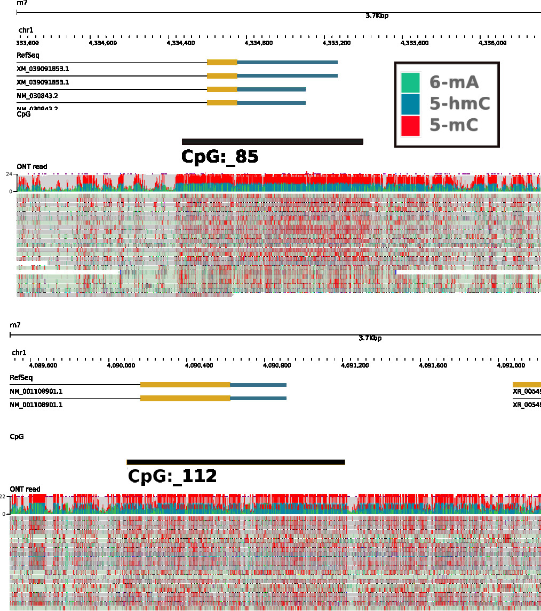
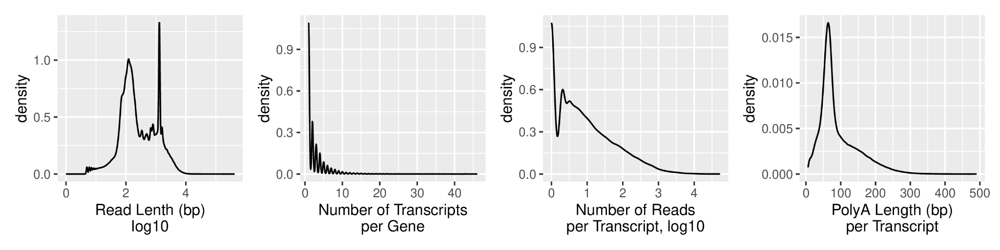
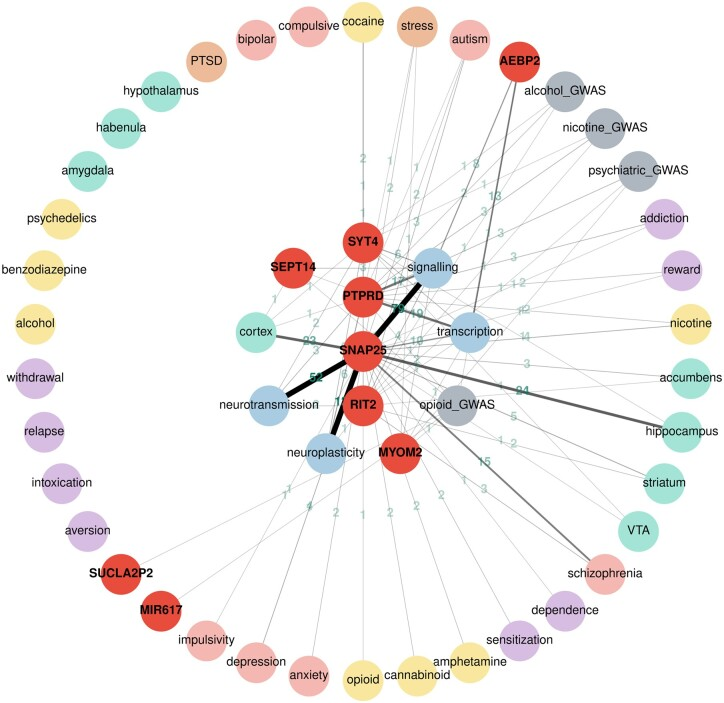

# P30 SMART Core

## Single Molecule AI-assisted RaT omics

### Hao Chen

---

## Specific Aims

- **Aim 1 - Community:** Enhance Access to Rat Genomic Resources for the NIDA Community through the International Rat Omics Consortium (IROC).

- **Aim 2 - Data:** Generate brain region-specific single-molecule long-read sequencing data from multiple strains of rats with divergent SUD-related phenotypes.

- **Aim 3 - Tools:** Analyze sequencing data using conventional and AI-assisted tools to extract biological insights and integrate findings with existing literature.

---

## Aim 1 | Community: IROC

- Monthly virtual meetings since 2019, participants from US and international groups, plus RGD, EBI, and NCBI.

- One biennual in-person meeting with hands-on workshops, seminars, and panel discussions.

- Invited experts have included Howe, Miga, Garrison, Doris, Murphy, Kwitek, and Avsec.

- Topics: T2T assemblies, pangenomics and pantranscriptomics, single-cell omics, epigenomics and epitranscriptomics, and AI.

---

## Aim 1 | Reference genome and annotation quality

- Assembly history: Rnor_6.0, then mRatBN7.2 in 2020 (about 129,000 potential base-level errors from PacBio CLR), then GRCr8 from PacBio HiFi, which still has more than 270 gaps.

- Doris and Chen are building telomere-to-telomere assemblies; pangenome and pantranscriptome graphs are the next step.

- Over 500 RefSeq and Ensembl inconsistencies in neuroscience genes identified by IROC were curated by HAVANA, EBI.

---

## The Nexus Panel

10 inbred strains plus outbred Sprague-Dawley rats.

- **Genetic coverage:** captures variation in HS rats and the inbred <a href="https://orip.nih.gov/sites/default/files/HRDP450x154.png">HRDP</a>, including HS founders and parents of two recombinant inbred panels.
- **Behavioral spread:** BN and F344 show the lowest intravenous nicotine intake, SHR among the highest; ACI and SHR show high oxycodone intake, BN and M520 the lowest.
- **Conserved risk genes:** high-impact variants in 19 genes whose human orthologs reach genome-wide significance in SUD GWAS, including four opioid use disorder genes (ARHGAP15, KDM4A, RABEPK, TANK) and cannabis-linked METTL15.
- **Design:** 6 rats per strain (3 female, 3 male), adults at 160-180 days.

---

## Aim 2 | Data: platform and design

<table style="font-size: 0.66em; width: 100%;">
<tr><th></th><th>PacBio</th><th>Oxford Nanopore (ONT)</th></tr>
<tr><td>Read length</td><td>15-30 kb; HiFi accuracy about 99.9%</td><td>10 kb to over 1 Mb; accuracy about 99%</td></tr>
<tr><td>Access</td><td>High instrument cost limits use to specialized centers</td><td>Instruments available to small labs and large centers</td></tr>
<tr><td>Base modifications</td><td>5-mC</td><td>5-mC, 5-hmC, 6-mA in DNA; more marks in RNA</td></tr>
</table>

SMART uses ONT for ultralong reads, direct modified-base detection, and local access.

- **Three data types:** whole-genome CpG methylation, direct RNA, and short- plus long-read snRNA-seq.
- **Design:** 11 strains, 6 rats per strain (3 female, 3 male), 3 brain regions, 160-180 days; 1-2 rats per sex per strain annually.
- **Targets:** about 20x coverage per CpG island; 5 million direct RNA reads per sample; 2,000-3,000 nuclei per sample.

---

## Aim 2 | Data: DNA methylation

<table style="width: 100%;">
<tr>
<td style="width: 28%; vertical-align: top;">

</td>
<td rowspan="2" style="vertical-align: top;">

- **Data type:** single-base 5-mC, 5-hmC, and 6-mA across the genome, by strain, sex, and brain region.
- Dorado calls modified bases; Modkit builds CpG pileups for JBrowse2; DSS or Modkit tests differential modification.
- These marks are implicated in SUD, but their genome-wide distribution in rat brain is largely unmapped.
- Preliminary T2T data show 5-mC and 5-hmC declining at transcription start sites, consistent with hypomethylation at active genes.

</td>
</tr>
<tr>
<td style="vertical-align: top;">

</td>
</tr>
</table>

---

## Aim 2 | Data: enriching DNA methylation coverage

<table>
<tr>
<td>

</td>
<td>

- Adaptive sampling uses real-time pore signal to reject off-target strands, so CpG islands are read preferentially from a whole-genome library.
- We have used the same approach to enrich assembly gaps and validate structural variants.
- This raises effective methylation coverage toward about 20x per CpG island without sequencing all regions equally.

</td>
</tr>
</table>

---

## Aim 2 | Data: direct RNA

- **Data type:** full-length native RNA, about 5 million reads per sample, without cDNA conversion.
- Each dataset carries isoforms, alternative polyadenylation sites, polyA tail length, and base modifications (5-mC, 6-mA, pseudouridine, inosine).
- These features affect mRNA stability, translation, and protein abundance.
- Analysis tools: Flair, Modkit, Aptardi, and FEELnc.
- These data also define strain- and region-specific reference transcriptomes for short-read quantification.

---

## Aim 2 | Data: what one gene carries

- Ncam1 shows the layers in a single direct RNA dataset: RefSeq models, polyadenylation sites, read coverage, nine expressed isoforms, and base modifications.
- A sharp coverage rise aligns with one polyadenylation site, linking isoform usage to RNA processing in the same view.

---

## Aim 2 | Data: snRNA-seq

<table>
<tr>
<td>

</td>

<td>

- **Data type:** single-nucleus expression from NAc, mPFC, and amygdala, with short and long reads from the same cDNA library.
- Split-seq (Parse Biosciences) needs no specialized instrument. Shared barcodes let long-read isoforms be projected into the short-read data.
- Preliminary data: about 2,000 nuclei per sample, 87,000 reads per nucleus, and about 5,000 genes per nucleus; the long-read library detected about 1,500 transcripts per nucleus at mean length 669 bp.

</td>

</tr>

</table>

---

## Aim 3 | Analysis: variant effect prediction

Most non-coding predictors are trained on human data, so SMART will test and adapt them for rat.

- Map up to 120 inbred strains to the current reference.
- Call SNPs and indels with DeepVariant; build a joint set with GLnexus.
- Annotate coding variants with SnpEff or ANNOVAR, Ensembl VEP, and PolyPhen-2 or SIFT.
- Predict non-coding effects with Enformer and AlphaGenome, then train DeepSEA.
- Fine-tune DNA Hyena with rat-specific sequence and functional data.
- Flag non-conserved regions with phastCons and phyloP.

---

## Aim 3 | Analysis: cell-type annotation and harmonization

- Manual annotation is slow and variable between analysts; scGPT, pretrained on 33 million cells, will be fine-tuned on rat tissue.
- Long-read isoforms will be projected into short-read datasets through shared barcodes.
- Label transfer will annotate Supported Grant datasets without reanalyzing them.
- Downstream: SCCAF clusters, EdgeR pseudo-bulk, Harmony integration, and mixed models for strain, sex, rat, and region.

---

## Aim 3 | Analysis: multi-omic integration

- Transcript and protein abundance often disagree. SMART reads that discordance as a signal of post-transcriptional regulation.
- Pseudouridine consistently increases protein output; m6A is context-dependent, degrading mRNA when read by YTHDF2 and stabilizing it when read by IGF2BP.
- With the SAM Core, **MOFA** integrates genomic, epigenomic, transcriptomic, epitranscriptomic, and proteomic data into latent factors that link upstream variants to downstream regulation.
- Limits: whole-region profiling, n=6 modest for within-strain sex effects, ONT accuracy about 99% versus 99.9%.

---

## Aim 3 | Analysis: literature-grounded hypotheses

- LLMs alone lack current literature and reliable citations.

- <input type="checkbox" id="genecup-img-toggle" class="popimg-toggle"><label class="popimg-label" for="genecup-img-toggle">GeneCup</label> mines a local PubMed mirror with an SUD ontology; a CNN disambiguates the word "stress."
- A preliminary Ncam1 analysis submitted 119 gene-keyword sentences to an LLM, with PMIDs carried into the output.
- Novelty and accuracy will be scored using date-restricted literature (for example, publications before 2000), as done previously with Chilibot.
- <a href="https://github.com/chen42/SourceCery" >SourceCery </a> supports human review of claims against their sources.
